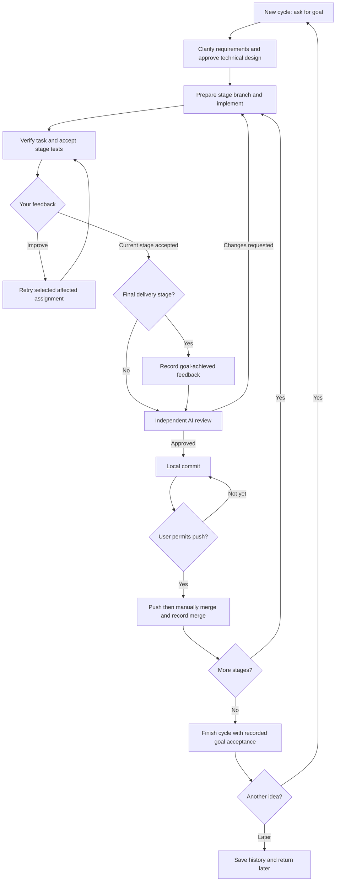
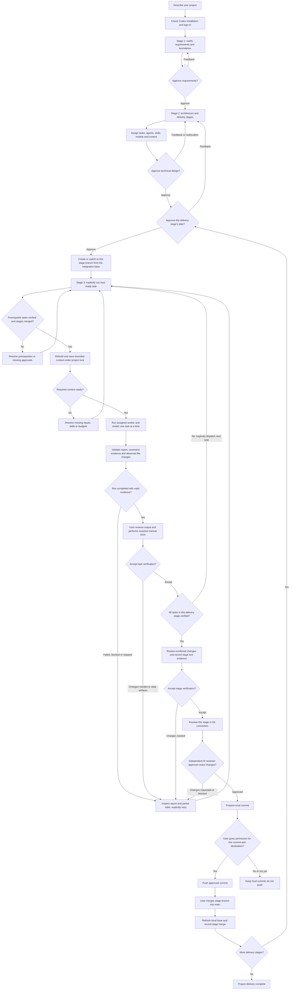

# Codex Project Orchestrator

## Terminal development cycles (first version)

A project can now contain numbered development cycles, each with a goal, UTC start and
completion timestamps, delivered changes, feedback and verified stage commit SHAs.
The existing planning, stage execution, review and Git gates are reused. No browser UI
changes are included in this version.



Start from the orchestrator repository with its Python environment activated:

```sh
orchestrator cycle new /path/to/project
orchestrator resume plans/session-EXAMPLE.json
orchestrator design plans/session-EXAMPLE.json
orchestrator cycle status plans/session-EXAMPLE.json
orchestrator cycle history plans/session-EXAMPLE.json
```

Use the real session path printed by the first command. For an existing session, use
`orchestrator cycle register SESSION` instead. Imported timestamps are estimated from the
session's modification time and marked imported. Keep sessions under ignored plans/.
Before delivering, initialize the project's Git repository, configure origin and Git identity,
and make an initial clean base commit. Use the default design output path.

Run `orchestrator cycle deliver --help` for terminal stage controls. With an approved
technical design, use these in order (replace SESSION and STAGE with actual values):

```sh
orchestrator cycle deliver SESSION enable --base main
orchestrator cycle deliver SESSION approve --stage STAGE
orchestrator cycle deliver SESSION prepare --stage STAGE
orchestrator cycle deliver SESSION run --stage STAGE
orchestrator cycle deliver SESSION verify --run-id RUN_ID
orchestrator cycle deliver SESSION accept --stage STAGE
orchestrator cycle deliver SESSION review --stage STAGE
orchestrator cycle deliver SESSION commit --stage STAGE
orchestrator cycle deliver SESSION push
```

Repeat run/verify for every task before accepting the stage. Before reviewing and committing
the final stage of a feedback-enabled cycle, record goal acceptance using the command below.
Review and verification prompts
require your actual checks. Push displays the exact commit, branch and remote and asks permission.
Manually merge on the Git host or in your terminal, refresh the local base if needed, and use
`orchestrator cycle deliver SESSION record-merge --stage STAGE`. Prepare the next stage only
after recording prerequisite merges. The delivery command also offers pause, resume, retry,
recovery and status actions. No inference or Git writes happen when viewing cycle history/status.

After every delivery stage has a recorded merge, return to the clean integrated base:

```sh
orchestrator cycle finish SESSION
orchestrator cycle next SESSION
```

Finish prompts for what changed and uses the final acceptance feedback. Legacy cycles that
have not enabled feedback rounds can still use the original finish prompt. Next prompts for the next goal and prints
a fresh session path. It carries the immediately preceding cycle's goal, outcomes, feedback
and commit references into the planner as historical context. Earlier cycle sessions and
artifacts stay available. Feedback does not automatically enlarge the next goal.
Between cycles, simply exit the terminal and later run cycle status/history. No automatic
inference, deployment, merge or push is triggered by finishing a cycle.

### Two types of feedback during a cycle

After testing, if a correction or addition fits an existing task's approved scope, enter:

```sh
orchestrator cycle feedback SESSION --kind improve --task TASK_ID
orchestrator cycle deliver SESSION retry --stage STAGE
```

The verify command also asks whether the current implementation task needs improvement before
acceptance. Running `orchestrator cycle feedback SESSION` without options prompts for the type,
note and affected task or final stage.

The terminal asks for feedback and displays the saved assignment, agent, workstream and exact
owned files. Only that selected assignment is retried, using its existing model and skills.
The new attempt includes your feedback and must pass its original checks plus a focused
feedback check. Verify the new attempt and accept the combined stage again. Other independent
verified tasks are preserved; previously executed dependent tasks or overlapping audited files
block the narrow retry. Do not select a frontend assignment for a database contract change.
Wider changes require an explicit design scope decision; this version does not automatically
expand ownership, create new tasks or migrate previous acceptance across a redesigned plan.
Feedback corrections must be recorded before the affected stage has a commit receipt.

When all other stages have recorded merges and the final stage's checks pass:

```sh
orchestrator cycle feedback SESSION --kind goal-achieved --stage FINAL_STAGE
orchestrator cycle deliver SESSION review --stage FINAL_STAGE
orchestrator cycle deliver SESSION commit --stage FINAL_STAGE
orchestrator cycle deliver SESSION push
```

Goal-achieved feedback is timestamped and binds the current test evidence. It becomes part
of the AI-review fingerprint and commit message (cycle number, note, timestamp and acceptance
ID). Even a no-change final verification stage creates a metadata-only commit so the feedback
is in Git history. AI approval and a separate explicit push confirmation are still required.
After manual merge and merge recording, finish the same cycle. New cycles use this final
acceptance gate by default; existing registered cycles adopt it when feedback is recorded.


A Python project planner and local execution coordinator, with a terminal interface and a
Streamlit dashboard. Plan frontend, backend, database and integration work, inspect each agent's
context, then run approved assignments through your installed Codex CLI one at a time.

## Current workflow

The diagram shows the implemented workflow as of 16 November 2026 (with stage branches enabled). Product stages 1–3 describe
the planner itself; **delivery stages** are the smaller implementation milestones it creates
for your project. Every delivery stage has its own approval and verification gates.



Frontend, backend, database, integration and general workers share one runner. Assignments
without owned files use read-only verification. A selected team of 1–8 logical agents still
executes sequentially. You can inspect context, reports, code diffs and the recorded Codex chat
from the agent workspace.

Every dispatch, retry and acceptance is explicit; refreshing never starts model work. Pause
requests cancellation and preserves partial edits; resume clears the pause and waits for another
dispatch. Feedback, reallocation and model changes that create a design revision require renewed
approval. A completed run waits for user verification; it does not automatically advance the
project. Stage acceptance records human evidence, while Git commit/push is available through explicit dashboard actions after stage acceptance.
Merging and deployment remain manual.

Try **New project → Try worker test project** in the dashboard and follow the
[worker acceptance checklist](docs/worker-testing.md). See the
[quality review](docs/quality-review.md) for current checks and remaining limitations.

## Stack

- Python 3.11+ for the script.
- Typer for commands and help.
- Pydantic for validated JSON plans.
- Streamlit for the optional local dashboard, with small browser components for selection
  and drag-and-drop.
- Git for checkpoints; pytest and Ruff for development checks.

Local JSON files store plans, approvals and run checkpoints. No database server or agent
orchestration library is required.

## Set up

From this repository's directory, with Python 3.11 or later installed:

```sh
python3 -m venv .venv
source .venv/bin/activate
python -m pip install -e '.[dev]'
orchestrator --help
```

The equivalent module entry point is `python -m codex_orchestrator`.
On this initialized workspace, `.venv` already exists and has the dependencies installed; start
with `source .venv/bin/activate` in each new terminal session.

In PyCharm, open this repository folder as a project and select the existing `.venv/bin/python`
as its Python interpreter. Run `python -m codex_orchestrator --help` in the PyCharm terminal.

Run `orchestrator setup` to check Codex installation and sign-in. Interactive planning also
runs this check after saving your initial idea. The program searches PATH, common install
locations, and the Codex CLI bundled with ChatGPT on macOS. To select a specific executable,
set `CODEX_EXECUTABLE` to its full path in your terminal environment.

If Codex is missing, setup offers to install `@openai/codex` with npm after confirmation. If
npm is unavailable or you prefer another method, it shows the official installation guide
and accepts the path to an installed executable. If sign-in is needed, it offers to open
Codex's browser login and verifies the result before continuing. Existing sign-ins are reused.
Codex handles credential storage. Setup keeps credentials out of the project files.

If you postpone setup, resume your saved session with `orchestrator resume` and its JSON path.
Setup is also available as a separate command so you can check it before starting a session.

## Local browser interface

Install the optional interface and start it from the repository directory:

```sh
python -m pip install -e '.[web]'
orchestrator web
```

Open [the local planner](http://127.0.0.1:8501) on this computer. The server binds to loopback. The browser uses
the same session files, Codex connection, validation, and approval actions as the terminal.
Start a session, answer questions, approve Stage 1, then switch to Technical design.

The “Try sample project” button copies a reading-list starter into an isolated Git repository
under the ignored `plans/samples/` directory and fills in its brief. Create the session and
choose Continue with Codex. The sample asks for a Python/Streamlit/SQLite reading tracker
with book entry, status filters, and persistent storage.

Use Check connection in the sidebar to inspect Codex sign-in. The browser can open Codex's
sign-in flow if necessary. For CLI installation, run `orchestrator setup` in the terminal.
Model requests are triggered by explicit actions. Reloading a saved plan makes no model request.

Stage checks are displayed as planned verification gates. The Dashboard can execute one
approved assignment at a time. Verification requires explicit user acceptance; merging is manual.

## Stage 1: interactive planning

With Codex CLI installed and signed in, start a session from your terminal:

```sh
orchestrator plan . --interactive -o plans/activity-session.json
```

Pass the directory of the project you want to plan for in place of `.`. You can also pass
an initial brief as an argument or with `--brief-file`. If you omit `-o`, the program creates
a unique session file under `plans/`.

1. Describe the feature. The intake model asks about gaps that affect scope or success criteria.
   Type `:plan` at an intake question to proceed with the information you have.
2. The planning model reads the brief and inspects the project. It can ask a clarification
   question before drafting. The plan links tasks to requirements and suggests a specialist
   role, difficulty, dependencies, scope, and automated and human checks for each task.
3. Review the dependency groups and the agent recommendation. Tasks in the same group have
   their dependencies satisfied at the same time. Whether they can run concurrently also
   depends on whether their changes overlap.
4. Choose `approve`, `revise`, or `save`. Approval records the current revision. A revision
   request opens a draft and keeps the previous plan in the session history.

Use `:save` at a question or resume after an interrupted call:

```sh
orchestrator resume plans/activity-session.json
```

The session JSON stores the conversation, structured brief, revisions, and approval. The
interactive workflow ends with the saved plan. It uses read-only Codex planning calls.
Set `--intake-model` and `--model` to choose intake and planning models separately, or
omit them to use your Codex configuration. `--timeout` applies per model call.

On first use, the terminal asks for the intake and planning model IDs that you have not
specified through flags. Press Enter to use the Codex configuration. Enter a model ID
available to your account to select it explicitly. `--planning-model` is an alias for `--model`.
At a question, type `:models` to change these choices. At the plan review prompt, enter
`models`. You can also override them when resuming:

```sh
orchestrator resume plans/activity-session.json --intake-model MODEL_ID --planning-model MODEL_ID
```

Use `default` in the selector or resume options to return to the Codex configuration. Choices
are saved per session. The terminal displays the requested model before each call and the
model reported by the CLI after a successful response. Some CLI versions omit model metadata.
In that case, the display explicitly says the model was unreported and shows the request
setting. Each response stores its stage and requested/reported model names, and each plan
revision keeps its own model attribution even after you change future model choices. Older
session files remain readable and display unknown model attribution where it was not recorded.

## Stage 2: technical design and staged agent workflow

Finish and approve a Stage 1 session, then pass its saved path to the architect:

```sh
orchestrator design plans/activity-session.json
```

The default output is beside the source, such as `plans/activity-session.design.json`.
The same command reopens it and resumes a saved question or draft. Use `--output` to create
a separate design, `--model` / `--architect-model` to choose the architect, and
`--agent-model` to set the initial model choice for proposed agents. Enter `default` to
use Codex's configuration. The architect initially inherits the Stage 1 planning model.

The full review displays the approved requirements and exclusions, repository findings,
components, interfaces, data flow, storage, technology choices, and staged delivery workflow.
Each assignment includes the responsible agent, scope, exact owned files, required and optional
context, model recommendation, selected model, skills, deliverables, checks, escalation,
and handoff. Skill availability is reported from the presence of a named `SKILL.md` file.
A missing or unverified skill remains a setup item.

Each delivery stage has a verification gate. It specifies agent checks with expected results,
required user tests, acceptance criteria, review and failure owners, and completion evidence.
The merge policy calls for actual check commands/results against the tested commit, review of
the combined stage changes, and any required user acceptance before merging. Dependent stages
are described by the plan as starting after verified merges. The initial runner enforces
accepted prerequisite verification; merge evidence still needs human review. Stage 2 approval
records approval of the design.

At review, choose `approve`, `revise`, `models`, or `save`. The model menu lets you change the
architect for future requests and the selected model for each proposed agent. Allocation
changes create a fresh reviewable revision. At an architect question, use `:models` to change
request defaults or `:save` to exit.

Display a saved design without a model request:

```sh
orchestrator design plans/activity-session.json --show
```

Designs retain the approved Stage 1 revision and a fingerprint of its snapshot. If Stage 1
is revised, approve its new revision and start a new design with a different `--output` path.
The old design stays available as a historical artifact. Required project-file context must
exist before approval. Invalid reference IDs, requirement coverage gaps, dependency cycles,
unordered writes to a shared declared file, and missing dependencies on required upstream
context are rejected. Validation feedback is saved for the next architect attempt.

These structural checks operate on the declared design. Semantic scope decisions still need
review. The runner uses the workspace-write sandbox, which permits project-wide writes;
declared owned paths remain instructions. Verified merges still require human review.
The architect uses the existing read-only Codex adapter. Sessions under `plans/` are ignored by Git.

See [Stage 2 manual checks](docs/stage2-testing.md) for a walkthrough and expected results.

## Create a starter plan

```sh
orchestrator plan . "Build an activity planner with saved activities" \
  --name activity-planner --output plans/activity-planner.json
```

Alternatively, put the brief in a UTF-8 file:

```sh
orchestrator plan . --brief-file examples/brief.md \
  --name activity-planner --output plans/activity-planner.json
```

The starter plan is a **generic offline template**. It records the brief but does not analyze it
or inspect project code. Review and adapt the tasks before implementation. The JSON records
`planning_mode: "template"` to make this explicit.

See [`examples/plan.template.json`](examples/plan.template.json) for a complete output example.

## Ask Codex to plan from a real project

Install the [Codex CLI](https://learn.chatgpt.com/docs/cli) if `codex --version` is unavailable,
then sign in. This optional mode needs a working Codex account and network connection:

```sh
codex --version
codex login
orchestrator plan /path/to/your/project "Add activity creation and editing" \
  --provider codex --output plans/activity-feature.json
```

Replace `/path/to/your/project` with an existing project directory. For a new project, create
the directory first. To use this repository as a planning example, use `.` instead.

This performs one Codex planning call. It asks Codex to inspect the project with read-only
operations and return structured tasks; the script validates the response before saving it.
The JSON records `planning_mode: "codex"`. Review the generated assumptions and acceptance criteria.

The adapter uses the officially supported
[`codex exec` interface](https://learn.chatgpt.com/docs/non-interactive-mode), with
`--sandbox read-only`, `--ask-for-approval never`, `--output-schema`, and
`--output-last-message`. The brief is passed through standard input, without a shell.
Authentication and the default model come from the CLI. There are no credentials in this repo.
Codex account usage applies when you select this provider.

Use `codex login status` to check your sign-in. If you need to sign in, run `codex login` and
complete the ChatGPT browser flow. Keep Codex's credential store outside the repository.
Git ignores `auth.json`, `.env` files, and generated plans under `plans/`. If you choose an
output path elsewhere, review the saved brief and session before staging it. Codex can read
project files during planning, so keep secrets out of the brief and use a project folder that
you are comfortable sharing with your signed-in Codex service.

Use `--model MODEL_NAME` to choose a model available to your account, and `--timeout 600` to
change the default 300-second timeout. Missing Codex, authentication failures, timeouts, and
invalid responses produce an error; they do not silently fall back to template tasks.

### Why use the CLI from Python?

Official OpenAI documentation currently supports both a
[Python SDK (`openai-codex`)](https://learn.chatgpt.com/docs/codex-sdk) and a TypeScript SDK.
This repository uses Python's standard-library `subprocess` module to call `codex exec`.
Planning uses bounded read-only requests; implementation uses persistent chats and streamed
JSON events. Both reuse the installed CLI and its sign-in. You do not need to write JavaScript
or install an SDK to use this code.

These interfaces were checked against official documentation on 2026-11-11 and the locally
installed Codex CLI `0.167.0-alpha.3.2`. Local help confirms the flags above. Older installations
may need updating if a flag is unavailable.

## What a plan contains

Each task includes its workstream, prerequisites, description, and acceptance criteria. Plans
reject duplicate IDs, unknown dependencies, self-dependencies, and cycles. The workflow allows
frontend work with mocks to begin once the contract is agreed, while database and backend work
progress along their own dependencies.

The project directory must exist. Output paths are relative to the terminal's current directory,
and missing output directories are created. Existing output files require `--force` to replace.
Only the chosen plan file is written; the command does not implement any tasks.
For Codex mode, the CLI also manages its own authentication/runtime files and temporary response
files. The script requests read-only project access and does not run the proposed implementation.

## Read the Python code

Start with `planner.py` for the offline template, or `coordinator.py` for the current execution
workflow. The main module boundaries are:

| File | What it does |
| --- | --- |
| `src/codex_orchestrator/planner.py` | Defines the generic offline workflow. |
| `src/codex_orchestrator/models.py` | Defines a task and checks the dependency graph. |
| `src/codex_orchestrator/cli.py` | Reads command-line options and writes the plan. |
| `src/codex_orchestrator/codex.py` | Sends a request and validates structured Codex output. |
| `src/codex_orchestrator/interactive.py` | Runs the terminal intake, planning, and review flow. |
| `src/codex_orchestrator/session.py` | Defines briefs and revisions and saves resumable checkpoints. |
| `src/codex_orchestrator/design.py` | Builds and revises technical designs from approved requirements. |
| `src/codex_orchestrator/coordinator.py` | Derives stage schedules and handles explicit dispatch and acceptance. |
| `src/codex_orchestrator/context_builder.py` | Builds bounded, inspectable assignment packages. |
| `src/codex_orchestrator/execution.py` | Manages the Codex process, project lock, cancellation and verification. |
| `src/codex_orchestrator/worker_models.py` | Defines worker contracts, reports and evidence. |
| `src/codex_orchestrator/worker_runtime.py` | Prepares contracts and reconciles final worker artifacts. |
| `src/codex_orchestrator/worker_audit.py` | Observes bounded file changes and produces diff evidence. |
| `src/codex_orchestrator/web.py` | Opens the local dashboard and planning forms. |
| `tests/` | Checks behavior using Python and pytest. |

The template starts with a contract, then separates database/backend work from frontend work
with mocks. Integration depends on both branches, and verification comes last. This expresses
possible coordination without starting workers. Approved interactive designs can use the
execution coordinator described above.

## Development

```sh
python -m pip install -e '.[dev,web]'
python -m pytest -q
ruff check src tests examples
ruff format --check src tests examples
```

Tests cover planning, revisions, approvals, dependency/stage gates, bounded context, worker
reports, file audits, cancellation and stale-artifact rejection. Model calls are mocked and
execution tests use local fake Codex programs. The suite does not spend account usage or open
native chats. Browser and real-account acceptance steps are documented separately.

## Next increments

1. Add independent stage review and richer test-evidence evaluation.
2. Add workflow metrics and compare completion time, tokens, tool calls, errors and test results
   against ordinary Codex runs.
3. Add durable process recovery and isolated Git worktrees before parallel worker execution.
4. Extend terminal execution controls and verified commit/merge evidence.

See the [project roadmap](docs/roadmap.md) for the Workflow Analyzer, Task Planner,
Performance Optimizer, and Evaluation Engine.

## Project dashboard

Home lists saved projects. Each project's Dashboard groups planned assignments into
Frontend, Backend, and Database, with shared/integration work listed separately.
Open an assignment to inspect its supplied context, skills, boundaries, model, and
saved read-only plan discussion. Start implementation runs from the same workspace.
Code output also offers a read-only preview
of existing source within that assignment's owned paths. Conversations stay in ignored
local session files and are separated by assignment and design revision.

See [browser testing instructions](docs/web-testing.md) for expected results.

## Implementation and Codex chats

Approve the technical design and the chosen stage's plan, then choose Start implementation.
The runner uses persistent `codex exec --json` sessions with the workspace-write sandbox
(read-only for verification assignments),
existing Codex sign-in, and the assigned model. Only one task can write in a project at a time.
The run panel refreshes every two seconds and shows events, agent output, status, and the
exact supplied prompt. Open chat in Codex launches `codex://threads/<recorded-thread-id>`;
the original context is visible in the chat's first message and downloadable from the panel.
Codex also loads its own user/project instructions; the displayed prompt is the context our
application supplies, not an inventory of Codex's internal context.

Drag cards between agent lanes, or use the reassignment form. To introduce another agent,
enter a new role and model in the form; its skills and boundaries are copied from the current
owner and should be reviewed. Reassignment preserves previous revisions and run history,
updates required handoffs, and invalidates approval. Stop an active run and wait for its stopped
status before moving work. Changes already made remain in the project for the next agent.

A completed Codex turn is not a test-pass verdict. Inspect its checks and run the required
manual tests, then accept verification. Dependent tasks wait for accepted prerequisite tasks.
The runner never automatically commits, merges, pushes, or deploys. Its prompt forbids those
actions; owned file boundaries are likewise instructions within the project sandbox.

Runs time out after 30 minutes. Logs and prompts are saved alongside the design in ignored
`plans/` storage. A hard planner crash may leave a project lock in the system temporary directory
(`codex-orchestrator-locks-<uid>`); check and stop the associated Codex process before removing
an abandoned lock. Ordinary shutdown requests cancellation and waits for workers to stop.

References: [Codex CLI](https://learn.chatgpt.com/docs/cli/reference) and
[local chat links](https://learn.chatgpt.com/docs/reference/commands).

## Maintaining the project

See [architecture and maintenance review](docs/architecture.md) for module boundaries,
state rules, reviewed efficiency improvements, and the remaining execution limitations.
Install both development extras (`.[dev,web]`) when working on the UI so its tests run.

## AI team allocation

After creating a technical design, the sidebar offers **AI team** settings on each project
page. Choose 1–8 logical agents and enter a role and accessible model ID (or `default`) for
each. **Suggest task assignments** makes one read-only planner request. Review its task-owner
mapping, reasons, skills, and stage verification owners, then choose **Apply suggested team**.
Applying preserves the task/stage graph and scope, creates a new design revision, and clears
approval. Review and approve the new design and stage plans before starting implementation.

The selected count is a logical team size, not parallel process concurrency. Current execution
still runs one task at a time. Every proposed agent must have a task or verification role;
unused agents and incomplete mappings are rejected. Settings and proposals are local session
data under ignored `plans/`. Refreshing or editing settings never makes a model request.
Task assignment reasons remain in the revision and are supplied to the assigned agent's context.

### Automatic job assessment

The architect assesses task difficulty, uncertainty, dependencies, specialties, context size,
and verification effort while generating the technical design. It chooses a small useful
team and records its reasoning and required model capabilities. The sidebar defaults to
**Planner recommendation** and displays that assessment; choose **Custom team** to override
count, roles, or concrete model IDs. Overall complexity summarizes the hardest planned task.
The assessment uses the latest architect revision, so manual reallocations do not erase the
original recommendation. No extra assessment call runs on page load or refresh. Existing
projects show their stored planner decisions; a new technical-design revision reassesses them.

## Stage 3: execution coordinator

The project Dashboard now includes **Execution coordinator**. Select a delivery stage and
choose **Run next ready task**. The coordinator uses the existing runner and the assigned
agent/model/context, selects a task whose prerequisites have accepted verification, and
keeps project writes sequential. Inspect task and verification opens its agent workspace
for live output, the native Codex chat, and task-level verification controls.

After each task completes, review its checks and accept task verification. Return to the
Dashboard and dispatch the next ready task. Refresh/polling never dispatches jobs. Failed
or stopped attempts block the stage until an explicit retry. **Pause coordinator** saves a
checkpoint and requests cancellation of an active run in this design; **Resume coordinator**
clears the pause but does not itself launch work. Existing changes remain on disk for retries.

When all stage tasks have accepted verification, record review/manual-test evidence and
choose **Accept stage verification**. Dependent stages cannot start before this acceptance,
even through the individual-task runner. Acceptance is tied to the latest verified run IDs
and the design revision, so a new attempt invalidates the previous acceptance. Checkpoints
live beside the design under ignored plans storage and survive browser/server restarts.

This is the first coordinator increment, not the complete Stage 3 pipeline. Automatic test-evidence grading, verified merges, durable crash recovery,
and parallel worktrees remain later increments. Human acceptance is not proof of a merge.

## Stage 3: context builder

Open an Agent workspace, choose **Context**, and select **Build context preview**. This
builds a versioned package locally without inference. It includes approved assignment metadata,
selected requirements/contracts, stage checks, declared project files, existing owned files,
applicable project AGENTS.md files, configured local SKILL.md content, and declared upstream
handoffs. It does not copy another agent's full conversation or crawl the repository.

Each resource shows why it is included, whether it is required, availability, content hash,
and its source run when applicable. Required missing/excluded/truncated inputs block execution;
optional inputs produce warnings. Uncreated owned files are expected. A skill with no configured
location is reported as unconfigured; a configured missing skill blocks implementation.

Default budgets are 128 KiB per package, 24 KiB per file, 16 KiB per handoff, and 32 unique
resources. **Context budgets** lets you change byte limits for future builds. These are byte
limits, not billed token counts. Narrow large assignments or raise appropriate limits when
required resources do not fit; the builder never silently drops required content to launch work.

Handoffs require the latest completed, user-verified prerequisite run from the current design
revision and a declared recipient when the owner changes. They include its final summary and
current produced source files. A failed newer attempt prevents reuse of an older success.
Legacy runs can supply their summary from a bounded tail of existing Codex events.

Execution rebuilds the package under the project writer lock and saves `context.json` beside
the run, with a digest recorded in run metadata. Use **Context package used for this run → Load
recorded context package** to inspect/download that snapshot. File/budget changes do not rewrite
saved run snapshots. The full supplied prompt remains available in the run panel and Codex chat.

Credential/private-key paths, binary files, generated dependency trees, symlink escapes, and
recognizable credential patterns are excluded from automatic context inclusion. These filters
are not a comprehensive secret scanner or a filesystem access boundary. Codex still has its own
configured instructions/tools and sandbox permissions. A preview is a snapshot, not a guarantee
that a human or native Codex follow-up has not changed the workspace since verification.

## Stage 3: worker agents

All task workstreams now have worker profiles: frontend, backend, database, integration, and
general. Assignments with empty owned_paths select the read-only verification profile. Workers
use the approved context, configured skills, assigned model and ownership, with focused instructions
for their domain. They return structured completion/blocked/failure reports rather than a prose-only
success message. The coordinator still dispatches one task at a time.

Each planned check has an ID. Reports are validated against the assigned identity/context and
matched to observed command/exit-code events. Workspace snapshots compare actual edits against
reported changes and owned files. Unsupported pass claims and scope violations block verification;
failed or invalid reports fail. Checks still require human review for semantic adequacy. Accepting
verification also rejects modified report artifacts or changed audited inputs/outputs. New runs
also record and check the full worker-specification and final-snapshot hashes. Older records
remain readable with their original checks; hashes detect inconsistencies rather than protect
against someone able to rewrite the run record itself. Unreadable assigned files before or
after execution block completion, and command evidence must match the exact reported command.

The workspace now displays Worker report, remaining human checks, and Load worker evidence
for command output and diffs. To try every worker type, choose **New project → Try worker test
project** and follow the [worker testing checklist](docs/worker-testing.md). Automated tests use
local fake Codex programs; real model behavior and native chat routing need your manual acceptance.

The CLI integration follows the [official structured-output Codex example](https://developers.openai.com/cookbook/examples/codex/build_iterative_repair_loops_with_codex).
Per-file ownership is post-run detection within the existing project sandbox, not a permissions
boundary. The runner leaves edits intact for review and never automatically rolls them back.

## Connect Git and publish AI changes

Open a project's **Dashboard → Git connection**. This panel is available before technical design
is complete. If the project is not a Git repository, choose **Initialize Git repository**; the
folder must be its own repository root. Create a repository on your Git hosting service, paste
its HTTPS URL or `git@host:owner/repository.git`, then choose **Connect to Git**. Existing origin
connections are reused; changing an existing origin is a terminal operation.

Authentication uses your computer's Git credential helper or SSH setup. For GitHub, sign in with
GitHub Desktop or run `gh auth login` in your terminal. Set your Git name/email there if needed.
Do not put a token/password in the repository URL or project files. Connecting stores the remote
locally; it does not create a hosted repository or validate network access. Push tests access.

1. Complete and verify the stage's tasks, then accept stage verification with your test evidence.
2. Select the stage in Git connection and choose **Preview accepted stage changes**.
3. Inspect the diff and file list. Only changed owned files from that stage are eligible. To
   narrow the list, select files and choose **Update preview for selected files**.
4. Run **Run independent review** and resolve any blocking findings. After AI approval, enter a
   commit message, confirm your file review, and choose **Commit reviewed AI changes**. This is local.
5. Inspect the AI review, commit SHA, remote and branch. Tick the permission checkbox and choose
   **Approve and push this commit**. Pushing
   publishes the commit and its existing branch history. It uses a normal push, with no force,
   pull, merge, branch switching or deployment. A rejected push needs terminal investigation.

The application performs these Git operations on behalf of the AI workflow. Worker model
processes continue to implement code without committing or pushing independently. Browser
refresh never publishes. Git writes share the project writer lock with Codex execution. Existing
staged changes block publication; resolve those in your terminal first. Only up to 64 selected
small text files (24 KiB each) can be published through this initial UI. Private paths, unreadable
files and recognizable credential content are excluded; these checks are not a full secret scan.

Previews are checked again under the writer lock before commit. Source changes since worker
execution require a rerun and verification. New design revisions, changed HEAD/branch/remote, or
new edits to committed files prevent pushing an old receipt. Commit/push metadata is stored beside
the design as `.publication.json` (under ignored plans/ by default). A failed push preserves the
local commit for retry. A failed commit may leave selected files staged; inspect your Git index.

Test with a disposable project and remote: connect it, verify/accept a stage, preview and commit,
then push. Expect only selected files in the commit and the displayed SHA on the remote branch.
Refresh before each action to confirm nothing publishes automatically. Fake-worker tests cover
stage gates, stale previews, index isolation, push failure/retry, and dashboard refresh behavior.

## Independent reviewer and permission before push

The required sequence is **AI review → local commit → your explicit permission → push**.
There is no automatic-push mode. Existing saved opt-in settings are ignored, and the former
review-and-publish API rejects combined publication requests.

1. Finish task tests and required human stage acceptance. Build a preview in Git connection.
2. Choose **Run independent review**. A separate read-only Codex turn inspects selected source,
   full diffs, requirements, stage gates and recorded command evidence. Set its model in
   **Review and publishing settings**. It returns approved, changes_requested or blocked.
3. Read findings and optionally **Load reviewer input**. A blocking finding, incomplete evidence
   or additional outstanding human checks prevents approval. Fix problems, rerun the worker
   checks and accept the stage again before a fresh review. User confirmation cannot bypass
   mandatory AI review.
4. After AI approval, confirm your file review and choose **Commit reviewed AI changes**. This
   creates only a local commit. Development branches under orchestrator/ remain recommended;
   **Create development branch** is available in settings.
5. The app shows the AI review, exact commit SHA, branch and remote, then asks permission to push.
   Tick **I give permission to push this commit to the destination shown above** and click
   **Approve and push this commit**. Leaving it unchecked or leaving the page keeps work local.

Neither AI approval, a local commit, nor stage acceptance grants push permission. Every push
request—including a retry—needs an explicit user action scoped to that commit and destination.
Refresh never calls the reviewer or publisher. There is no automatic merge or deployment.

AI approvals bind selected contents/diffs, design, latest task attempts, evidence, base HEAD,
branch and remote. A newer review supersedes the old decision, including a failed/timed-out
review. Changes invalidate approval. Commit receipts bind the required AI review, evidence and
selected tree; changed inputs or altered reviews block pushing. A permission for a different
commit, branch or remote is rejected by the Git service, even if called outside the UI.

Review inputs are limited to 256 KiB and never silently truncated. Artifacts are stored beside
the design in .reviews.json, .review-policy.json and .review-inputs/ (ignored under plans/ by
default). Older receipts without the required AI review remain readable but cannot be published
through the new gate. Inspect such commits in your terminal.

This is model review plus user permission, not a correctness guarantee or isolation from someone
who can rewrite local application state. Required tests, ordinary Git authentication, sequential
writer locking and manual merge/deployment remain. See [reviewer acceptance tests](docs/reviewer-testing.md).

## One branch per delivery stage

In **Dashboard → Execution coordinator → Delivery stage branch**, enable stage branches for the
approved design revision. Existing projects keep their previous execution behavior until this
explicit upgrade. No branches are renamed or reset automatically. The runner remains sequential;
frontend/backend/database are agent roles, not permanent branches.

Start on a clean, committed integration base (normally main). For an empty repository, create an
initial README/.gitignore commit in your terminal first. Keep generated plans, logs, environments
and credentials ignored. Enter the base branch and choose **Enable stage branches for this revision**.

For each delivery stage:

1. Select the stage and choose **Create or switch to stage branch**. Names include a project/design
   identifier and revision, followed by `stage-1-storage`, `stage-2-api`, etc. The branch starts at
   the local base. The app does not reuse an unrelated existing branch or carry dirty files across.
2. Run tasks, verify actual results and accept the stage's manual checks. All workers for this
   stage share that branch. Retrying on the same branch preserves partial work. The direct task
   runner enforces the same branch gate as the coordinator.
3. In Git connection, preview the stage, obtain AI review, and prepare the local commit. Give your
   explicit permission to push the displayed SHA/branch/remote. Only selected files are published.
4. Merge the stage branch into the base yourself, using your Git host or terminal. Use a normal
   merge or fast-forward. If merged remotely, choose **Refresh base from origin**: this explicitly
   fetches and fast-forwards the local base. Divergence stops with an error; nothing is reset.
5. Choose **Record stage merge into base**. The app checks the pushed receipt, AI review, evidence
   and approved commit's ancestry in the local base. Stage acceptance alone is insufficient.
6. Only then prepare a dependent stage. It starts from the integrated base. Even independent
   stages run one at a time and must finish their merge checkpoint before another stage starts.

Verification-only stages may produce no source changes. They still need tests, stage acceptance,
AI review and push permission; their receipt uses the existing commit instead of an empty commit.

Branch checkpoints are stored beside the design in `.stage-branches.json`, with separate revision
history. Enabling does not invent branch provenance for old runs: rerun those tasks on their stage
branch. New design revisions require explicit setup on the clean base; previous branches/history
are retained. Polling only reads state and never switches branches, fetches, merges or publishes.

This first version recognizes ancestor-preserving merges only. Squash/rebase merges replace the
reviewed SHA and cannot satisfy the merge checkpoint. Complete those workflows outside the app
or use normal merge/fast-forward for managed stages. The checkpoint validates local ancestry and
recorded evidence, not a hosting provider's branch-protection rules or the correctness of later
base edits. Parallel workers still require separate worktrees in a future increment.

See [stage branch acceptance checks](docs/stage-branch-testing.md).

## Resume previous work

On Home, choose **Resume project** for a saved project. This reads checkpoints and opens the
recommended Requirements, Technical design, Dashboard or Agent workspace page. It does not
start a model call. Existing projects can also choose **Check saved progress** after opening.

The Resume project panel shows the last completed step, current Git branch/HEAD when available,
pending task/stage, detected problems and the next explicit action. It recognizes saved intake
or architect questions, design approval, active work, interrupted attempts, task verification,
AI review, a local commit awaiting push permission and a pushed stage awaiting its merge. Source,
review/evidence or destination changes are flagged rather than treated as current acceptance.
The panel rechecks state on page reruns; **Go to recommended step** only changes navigation.

A retry starts a new worker attempt with a rebuilt context and a bounded recovery brief. The
brief includes the same task's latest attempt ID/status, earlier summary/error, historical
command/exit-code observations, scope violations and current owned-input hashes. It instructs
the worker to inspect existing partial edits and rerun all required checks. It does not replay
an old prompt or claim past tests still pass. Earlier attempts and code edits are preserved.

For an interrupted worker:

1. Inspect the recorded Codex chat/processes and partial files. A live owning application,
   worker PID or process group prevents recovery and another writer.
2. When the app can identify a single unfinished worker and finds no live owner/worker/group,
   the panel offers **Recover interrupted worker**. Confirm that you inspected partial edits
   and stopped external writers, then click it. This records stopped/unverified status and
   releases only the matching project lease; it never deletes files or kills processes.
3. Explicitly retry from the agent workspace/coordinator. Expect a new attempt with recovery
   context, fresh tests and the normal verification, AI-review and push-permission gates.

New jobs save owner/process metadata; old sessions remain readable. Legacy/unreadable locks,
interrupted Git/review locks, multiple ambiguous unfinished runs, and a crash in the tiny window
before a worker PID is saved require terminal/process inspection and manual lock recovery. The
app does not delete a lock because it is old or assume an unknown process has stopped. Review
attempts without a final decision remain blocked; rerunning review is an explicit action.

This is local recovery, not a durable background supervisor. External/native writers and detached
children can escape application observation; process checks plus your confirmation complement
rather than replace that boundary. No saved push permission is restored: each push needs your
explicit approval of the displayed commit and destination. See [recovery acceptance checks](docs/recovery-testing.md).
